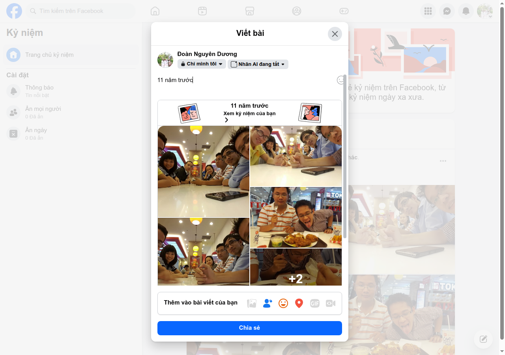
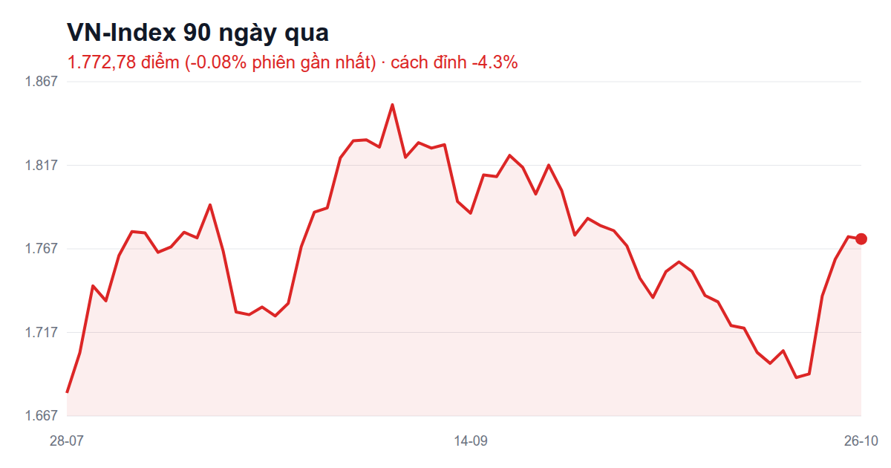
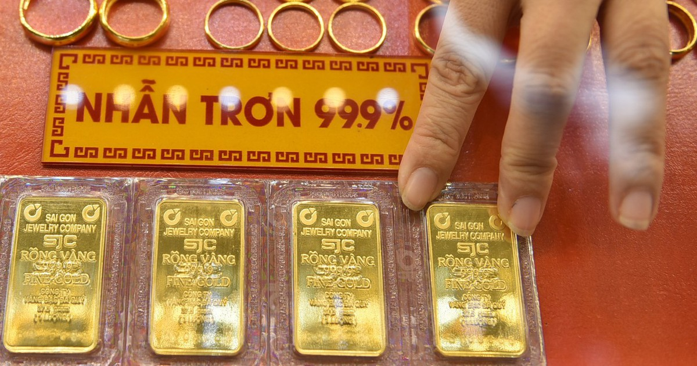
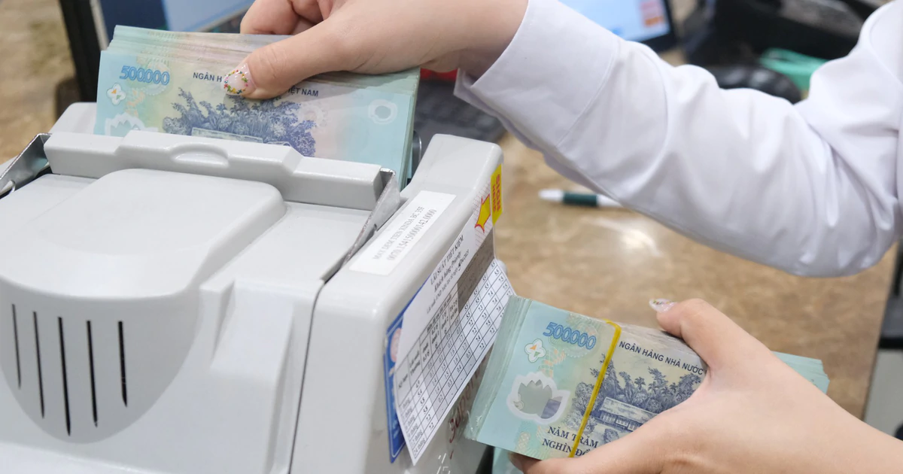
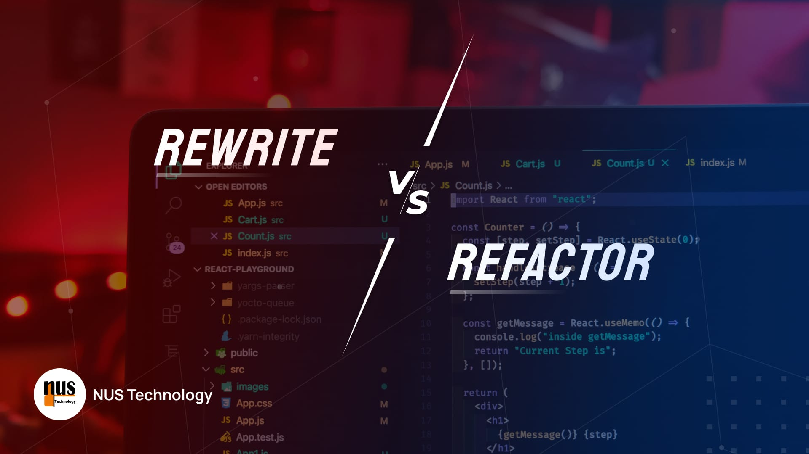

# FB post ứng viên 2026-10-26 (11:35, soạn lại kèm nguồn)

Bối cảnh: FB user 3 ngày qua = chạy bộ (25/10 công khai + 26/10 bản nháp 'Chỉ mình tôi' 5km), chứng khoán (24/10), rớt wifi (23/10) → chạy bộ để cuối. Strava: tháng 214,9 km, năm 961,1 km, không milestone. Kỷ niệm hôm nay: 1 vui (gà rán 11 năm), 2 bài buồn/khó hiểu → bỏ.

## trend

### 1. [trend] 2026 là 2016 mới — cảm xúc: ngốc nghếch
**Nguồn:** Internet đã quyết định: 2026 là 2016 mới — Kenh14 — https://kenh14.vn/internet-da-quyet-dinh-2026-la-2016-moi-215261601134845706.chn
> Trào lưu cả mạng đăng lại ảnh/phong cách năm 2016, coi 2026 là 'bản làm lại' của 2016.


```
Mạng xã hội bảo 2026 là 2016 mới 📼
Mình lục ảnh 2016 ra xem: tóc còn dày, ví thì mỏng 😅
10 năm sau ví vẫn y chang, chỉ có tóc là bắt kịp xu hướng 🫠
```

### 2. [trend] Hey Siri, tua về Chủ nhật — cảm xúc: hoang mang
**Nguồn:** Tổng hợp từ vựng, câu nói trend TikTok hài hước của giới trẻ — Phong Vũ Tech — https://phongvu.vn/cong-nghe/tong-hop-tu-vung-trend-2025/
> Câu meme 'Hey Siri, tua về Chủ nhật' vẫn được dân văn phòng dùng mỗi sáng thứ Hai.

```
Sáng thứ Hai mở mắt: "Hey Siri, tua về Chủ nhật" 🙏
Siri im re, chỉ có báo thức kêu thêm lần nữa ⏰😅
Ai cũng đang tua giống mình không 🙋‍♂️
```

### 3. [trend] Chụp trần nhà nhận thông điệp vũ trụ — cảm xúc: thư thái
**Nguồn:** Một chiếc trend đang viral: Chụp ảnh trần nhà để nhận thông điệp từ vũ trụ — Kenh14 (mục Hot trend) — https://kenh14.vn/hot-trend.html — ⚠️ chưa xác minh được bài gốc (chỉ thấy tiêu đề trong mục, search không ra)
> Dân mạng chụp trần nhà rồi 'giải mã' xem vũ trụ nhắn gì cho mình — trend vui kiểu bị cuộc đời dí.

```
Trend mới: chụp trần nhà để nhận thông điệp từ vũ trụ 🌌📸
Mình chụp thử, vũ trụ nhắn đúng một câu: "trần bám bụi rồi, lau đi" 🧹😂
```

## fb-memory

### 4. [fb-memory] Kỷ niệm 11 năm: hội bạn đi ăn gà rán — cảm xúc: hạnh phúc
**Nguồn:** Ngày này 11 năm trước — bài của Hoàng Huyền (gắn thẻ mình + bạn bè) — Facebook kỷ niệm
> Album ~7 ảnh: cả hội selfie quanh bàn ở quán gà rán trong trung tâm thương mại, đĩa gà rán, mặt ai cũng nhí nhố. Caption gốc là câu đùa 'Sau khi đánh nhau thì chúng tôi đi ăn với nhau'.


```
11 năm trước, cả hội kéo nhau đi ăn gà rán, selfie méo cả mặt 🍗📸
Giờ muốn gom đủ người chắc phải hẹn trước cả tháng 😅
```

## stock-humor

### 5. [stock-humor] Thị trường hồi phục, mình hồi hộp — cảm xúc: hoang mang
**Nguồn:** VN-Index hồi phục mạnh, mục tiêu 1.800 điểm trước áp lực rung lắc — VnEconomy (qua news digest 26/10) — https://news.google.com/articles/CBMikgFBVV95cUxPZzF1TTYzQWxoQXRENklkT2UxYklycVR6U3BEcnR1MGNtZ21VOWZYNG9wVk5hY2k4YWdWZ3hjUmJNMHFCcHlWVUNQY1ExUEtHVDhzNkpjR0FLMmhtWWNCeklvRWZLbjM1TVZ5dHcxaFRjQXQtQUtVVVl4YWpmZjR4WEI4bmx6YWU0TlJHYm5hYVFRZw
> Chỉ số hồi mạnh cuối tuần, giới phân tích kỳ vọng tiếp tục lên nhưng còn rung lắc. Ảnh đăng kèm: biểu đồ VN-Index 90 ngày.


```
Báo nói chứng khoán hồi phục mạnh 📈
Mình mở app ra xem... tim cũng hồi hộp mạnh 😵
Hồi phục là của thị trường, hồi hộp là của mình 🫠
```

### 6. [stock-humor] Chứng khoán 30 tuổi, mình tóc bạc — cảm xúc: ngốc nghếch
**Nguồn:** Từ hai mã cổ phiếu đến thị trường vốn hơn 10 triệu tỷ đồng — Tạp chí Kinh tế - Tài chính — https://tapchikinhtetaichinh.vn/tu-hai-ma-co-phieu-den-thi-truong-von-hon-10-trieu-ty-dong-165879.html
> Nhìn lại 30 năm ngành chứng khoán VN: từ 2 mã SAM, REE đến hơn 1.500 mã, vốn hóa ~10,3 triệu tỷ.


```
Chứng khoán Việt Nam tròn 30 tuổi 🎂
Mình mới chơi được vài tháng
Mà tóc bạc nhanh như đã chơi 30 năm 😅👴
```

### 7. [stock-humor] Thứ Hai tự hứa không mở app — cảm xúc: tích cực
**Nguồn:** (Tự sự) — đầu tuần mới, không dựa trên bài báo — tự viết
> Chuyện tự trào thói quen mở app chứng khoán ngay giờ mở cửa sáng thứ Hai.

```
Thứ Hai tự hứa cả tuần không mở app chứng khoán 🙅‍♂️
Hứa lúc 8h55, phá lời hứa lúc 9h01 📱😂
Ai giữ được lời hứa này chỉ mình với 🙏
```

## share-article

### 8. [share-article] 30 năm chứng khoán VN — cảm xúc: hào hứng
**Nguồn:** Từ hai mã cổ phiếu đến thị trường vốn hơn 10 triệu tỷ đồng — Tạp chí Kinh tế - Tài chính — https://tapchikinhtetaichinh.vn/tu-hai-ma-co-phieu-den-thi-truong-von-hon-10-trieu-ty-dong-165879.html
> 30 năm trước sàn chỉ có 2 mã cổ phiếu, nay hơn 1.500 mã, vốn hóa ~80% GDP.

```
30 năm trước sàn chứng khoán chỉ có đúng 2 mã 😮
Giờ hơn 1.500 mã, mà mình vẫn chọn trúng mã... đứng im 😅📊
https://tapchikinhtetaichinh.vn/tu-hai-ma-co-phieu-den-thi-truong-von-hon-10-trieu-ty-dong-165879.html
```

### 9. [share-article] Giá vàng gãy mốc 4.000 USD — cảm xúc: thư thái
**Nguồn:** Gãy mốc 4.000 USD/ounce, tuần này giá vàng sẽ ra sao? — Tuổi Trẻ, 26/10 — https://tuoitre.vn/gay-moc-4000-usd-ounce-tuan-nay-gia-vang-se-ra-sao-100261026000239089.htm
> Vàng thế giới rơi dưới 4.000 USD/oz, diễn biến tuần tới khó đoán vì căng thẳng Mỹ–Iran.


```
Vàng gãy mốc 4.000 USD 🪙📉
Người có vàng thì lo, người không có vàng như mình thì... ngủ ngon 😴😂
https://tuoitre.vn/gay-moc-4000-usd-ounce-tuan-nay-gia-vang-se-ra-sao-100261026000239089.htm
```

### 10. [share-article] Lãi suất niêm yết giảm, lãi thật vẫn cao — cảm xúc: hoang mang
**Nguồn:** Lãi suất niêm yết giảm, lãi suất 'thật' vẫn '8 chấm, 9 chấm' — Tuổi Trẻ, 25/10 — https://tuoitre.vn/lai-suat-niem-yet-giam-lai-suat-that-van-8-cham-9-cham-100261025182615595.htm
> Ngân hàng hạ lãi suất trên bảng theo chỉ đạo NHNN, nhưng người đi vay thực tế vẫn chịu 8–9%.


```
Lãi suất trên bảng thì giảm, đi vay thật thì vẫn "8 chấm, 9 chấm" 🤔
Giống giá trên menu với giá lúc tính tiền vậy đó 😅🧾
https://tuoitre.vn/lai-suat-niem-yet-giam-lai-suat-that-van-8-cham-9-cham-100261025182615595.htm
```

### 11. [share-article] AI chưa đem lại lợi nhuận cho đa số công ty — cảm xúc: ngốc nghếch
**Nguồn:** AI delivers zero financial payoff to most companies, according to Apollo economist — TechCrunch, 25/10 — https://techcrunch.com/2026/10/25/ai-delivers-zero-financial-payoff-to-most-companies-according-to-apollo-economist/
> Chuyên gia kinh tế Apollo: phần lớn công ty dùng AI vẫn chưa thấy lợi nhuận tài chính rõ rệt.


```
Đọc tin: đa số công ty dùng AI mà chưa thấy lời đồng nào 🤖💸
Nghe giống mình mua chứng khoán ghê, hy vọng thì nhiều, lãi thì để sau 😅
https://techcrunch.com/2026/10/25/ai-delivers-zero-financial-payoff-to-most-companies-according-to-apollo-economist/
```

## nus-blog

### 12. [nus-blog] Native hay cross-platform — cảm xúc: hào hứng
**Nguồn:** Native vs. Cross-Platform: A No-Nonsense Guide for Your Business App — NUS Technology blog — https://www.nustechnology.com/blog/native-vs-cross-platform-a-no-nonsense-guide-for-your-business-app
> So sánh làm app riêng cho iOS/Android với 1 app chạy cả hai (Flutter/React Native) về tốc độ, chi phí, hiệu năng.


```
Làm app riêng cho iPhone, Android hay 1 app chạy cả hai? 📱🤔
Công ty mình viết bài giải thích dễ hiểu, khỏi cãi nhau nữa 😄
https://www.nustechnology.com/blog/native-vs-cross-platform-a-no-nonsense-guide-for-your-business-app
```

### 13. [nus-blog] Viết lại hay sửa dần phần mềm cũ — cảm xúc: tích cực
**Nguồn:** Rewrite vs. Refactor: Why We Almost Always Choose Incremental Modernization — NUS Technology blog — https://www.nustechnology.com/blog/rewrite-vs-refactor-why-we-almost-always-choose-incremental-modernization
> Vì sao đập đi viết lại thường thất bại, và cách sửa dần từng phần để hệ thống vẫn chạy.


```
Nhà cũ thì sửa dần hay đập đi xây lại? 🏠🔨
Phần mềm cũng vậy, và team mình thường chọn sửa dần cho chắc ăn 😄
https://www.nustechnology.com/blog/rewrite-vs-refactor-why-we-almost-always-choose-incremental-modernization
```

### 14. [nus-blog] Làm 1 nền tảng SaaS tốn bao nhiêu — cảm xúc: hoang mang
**Nguồn:** Cost to Build a SaaS Platform in 2026 — NUS Technology blog — https://www.nustechnology.com/blog/cost-to-build-a-saas-platform-in-2026
> Đa số ước tính chi phí làm SaaS đều sai; bài chia nhỏ chi phí thực tế dựa trên các dự án đã làm.


```
Hỏi "làm cái app này hết bao nhiêu?" giống hỏi "xây cái nhà hết bao nhiêu?" 🏗️😅
Bài này của công ty mình trả lời thật lòng, đọc xong đỡ giật mình 💸
https://www.nustechnology.com/blog/cost-to-build-a-saas-platform-in-2026
```

### 15. [nus-blog] Bỏ giấy tờ cho thợ đi hiện trường — cảm xúc: tích cực
**Nguồn:** Why Paperless Workflows Matter More in Field Operations — NUS Technology blog — https://www.nustechnology.com/blog/why-paperless-workflows-matter-more-in-field-operations
> Với đội thợ làm ngoài hiện trường, giấy tờ dễ thất lạc làm trễ hóa đơn; bài nói cách số hóa để dùng được cả khi mất mạng.


```
Giấy tờ để trong xe, gặp mưa là... bay màu luôn hoá đơn 🌧️📄
Công ty mình có bài về chuyện bỏ giấy cho thợ đi công trình 😄
https://www.nustechnology.com/blog/why-paperless-workflows-matter-more-in-field-operations
```

## running

### 16. [running] Năm nay sắp cán 1.000 km — cảm xúc: hào hứng
**Nguồn:** Strava: tổng năm 2026 = 961,1 km (162 buổi) — Strava — https://www.strava.com/activities/20731911751
> Tổng km năm 961,1 km, còn ~39 km nữa là chạm mốc 1.000 km; buổi gần nhất 5,0 km sáng 26/10.

```
Năm nay đôi chân chạy được 961 km rồi 🏃‍♂️
Còn 39 km nữa là tròn 1.000, hứa không đi taxi đoạn cuối 😆
https://www.strava.com/activities/20731911751
```

### 17. [running] Tháng 10 hơn 214 km — cảm xúc: khỏe mạnh
**Nguồn:** Strava: tổng tháng 10 = 214,9 km — Strava — https://www.strava.com/activities/20731911751
> Tháng 10 chạy 214,9 km; buổi gần nhất 5,0 km, 37 phút, pace 7:22/km sáng 26/10.

```
Tháng 10 đôi chân đã chạy hơn 214 km 🏃‍♂️
Tính ra chạy từ Sài Gòn ra tới... Phan Thiết ngắm biển rồi đó 😆🌊
https://www.strava.com/activities/20731911751
```

## Ghi chú
- `idea`: thiếu — `docs/fb-post-ideas/` chỉ có README, chưa có ý tưởng nào.
- `fb-memory`: chỉ 1 — kỷ niệm 14 năm ('4-5 người kêu buồn') và 15 năm ('sao mọi người lại làm vậy') mang tâm trạng buồn/khó hiểu, bỏ theo quy tắc.
- `trend` #3: Kenh14 mới thấy tiêu đề ở mục Hot trend, chưa mở được bài gốc → link trang mục.
- `running`: hôm nay đã có bản nháp 'Chỉ mình tôi' (5km sáng nay) — nếu chọn bài chạy, cân nhắc xoá bản nháp đó (`--delete`).

Chọn bài: `/me:fb-post --pick <số>`

## Đã đăng
- #9 (đổi sang giá vàng nhẫn VN, caption theo user) → https://www.facebook.com/dnduong.us/posts/pfbid0d2ioLHV3PsXSit4o8LUqhHqXm5Bdcb1SDcsM76Qi8UgJmQeHvKxnroEFA75G2nhKl (Công khai, Trello complete)
