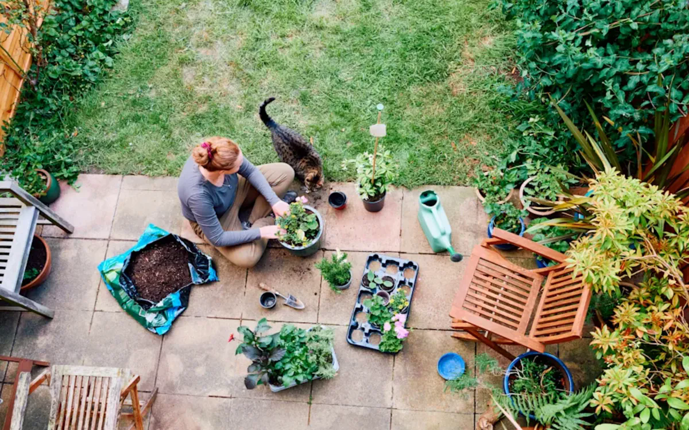
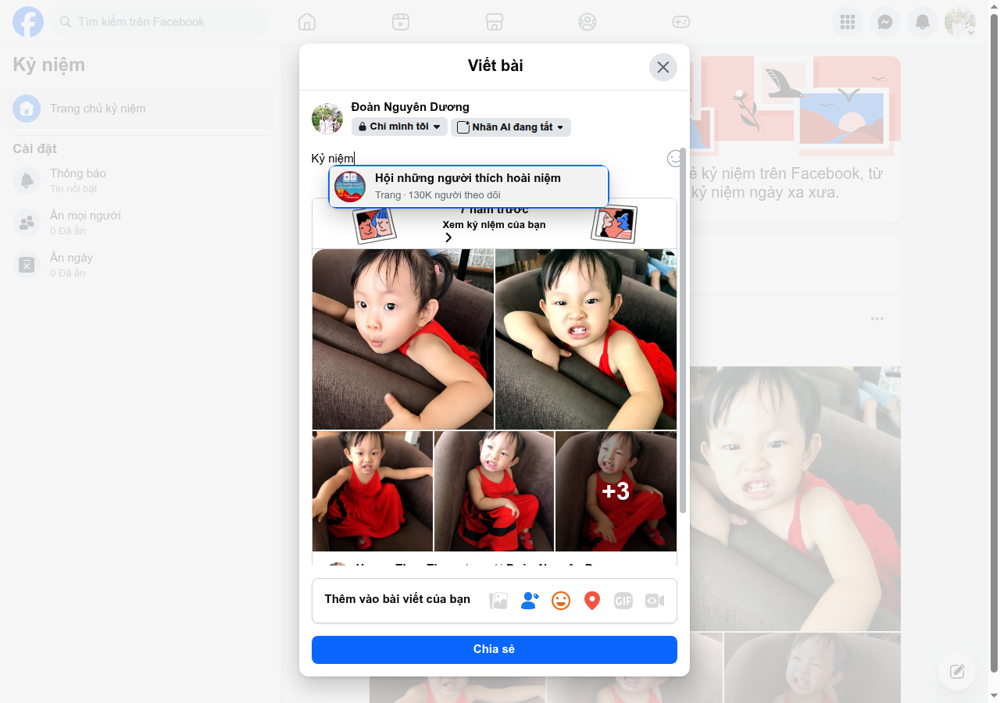
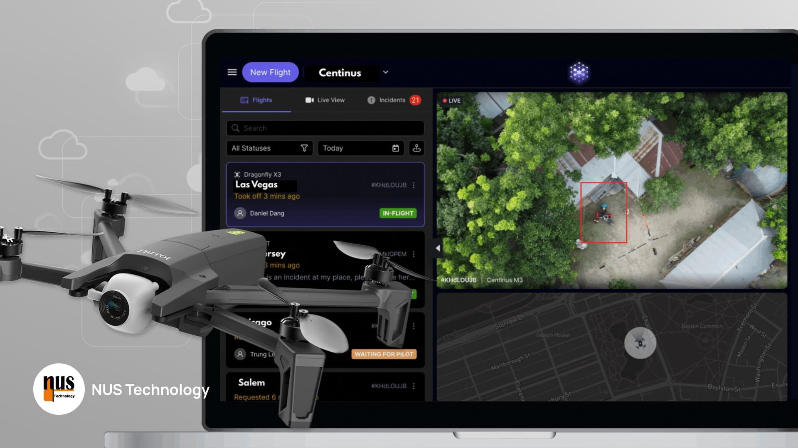
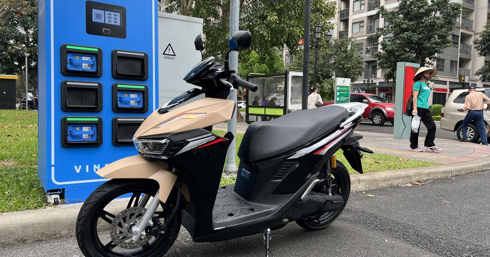
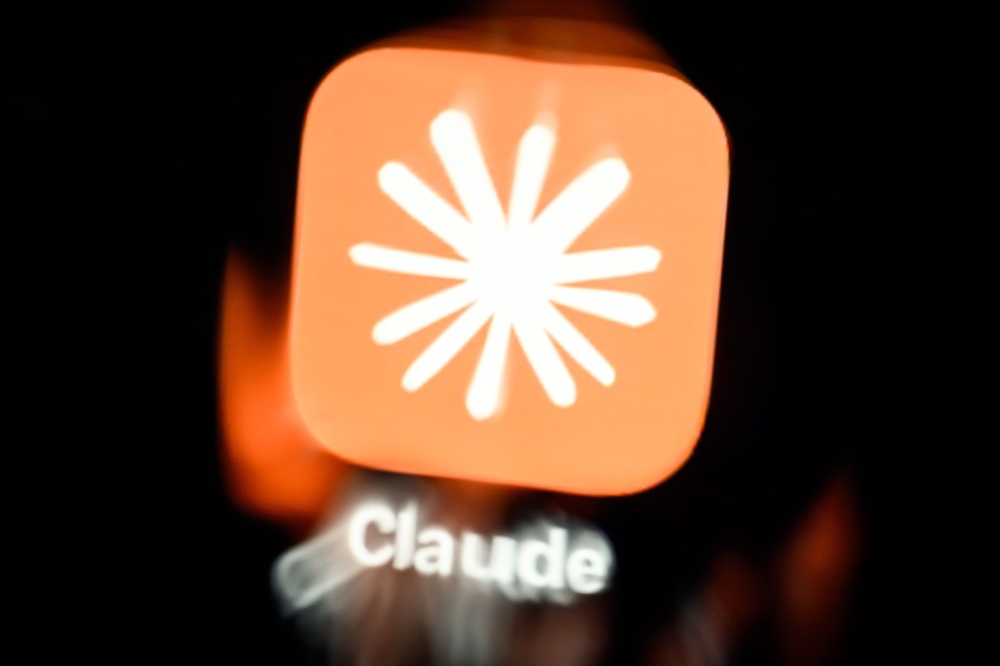
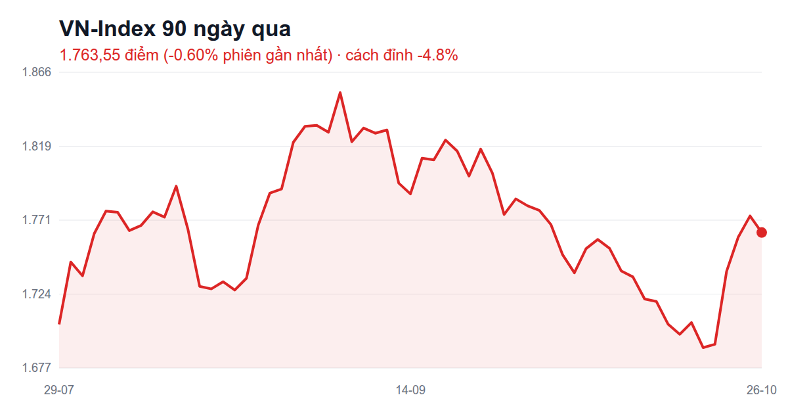

# FB post ứng viên 2026-10-27

Bối cảnh: user vừa đăng giá vàng (hôm qua), chạy bộ+matxa & chứng khoán (2 ngày trước) → hạ ưu tiên chạy bộ/chứng khoán, đưa trend/kỷ niệm/NUS lên đầu. Strava sáng nay 5 km, năm 966,1 km (chưa milestone). Kỷ niệm: 1 (7 năm trước, bé cà phê chủ nhật).

### 1. [trend] Aura farming — cày thần thái — cảm xúc: hào hứng
**Nguồn:** “Bá khí”, “aura farming” phủ sóng MXH — Kenh14, 26/09/2026 — https://kenh14.vn/trend-ba-khi-va-aura-farming-khi-ca-coi-mang-thi-nhau-cay-than-thai-lap-han-san-dau-hao-quang-215260926145347567.chn
> Giới trẻ quay video ngắn chấm điểm thần thái, lập "sàn đấu hào quang" ở trường, dùng Siuuu, mewing, meme 6-7.

Giới trẻ đang thi nhau "cày aura", chấm điểm thần thái 😎
Mình cũng thử… đứng tạo dáng trước gương được 3 giây thì con gái hỏi "ba bị đau bụng hả" 🫠
Aura của mình chắc đang bảo trì 😅
https://kenh14.vn/trend-ba-khi-va-aura-farming-khi-ca-coi-mang-thi-nhau-cay-than-thai-lap-han-san-dau-hao-quang-215260926145347567.chn

### 2. [trend] Trend than nghèo — cảm xúc: hết tiền
**Nguồn:** Bất ngờ với trào lưu “than nghèo” của giới trẻ — Kenh14 — https://kenh14.vn/bat-ngo-voi-trao-luu-than-ngheo-cua-gioi-tre-215260525165936375.chn
> Thay vì khoe sang chảnh, người trẻ chia sẻ lương thấp, mẹo tiết kiệm, đồ săn được giá rẻ.

Nghe nói giới trẻ giờ không khoe giàu nữa mà thi nhau "than nghèo" 💸
Trend này mình theo từ trước khi nó thành trend, khỏi tập cũng giỏi 😆
Ai cùng hệ điểm danh 🙋
https://kenh14.vn/bat-ngo-voi-trao-luu-than-ngheo-cua-gioi-tre-215260525165936375.chn

### 3. [trend] 2026 là 2016 mới — cảm xúc: hoài niệm
**Nguồn:** Internet đã quyết định: 2026 là 2016 mới — Kenh14 — https://kenh14.vn/internet-da-quyet-dinh-2026-la-2016-moi-215261601134845706.chn
> Dân mạng hồi sinh nhạc, meme, filter tai chó Snapchat, thử thách lật chai nước của năm 2016.

Cả mạng đang rủ nhau quay về 2016 🕰️
Mình thì khỏi quay, cái điện thoại với cái quần jeans vẫn còn ở 2016 nguyên đó 😂
https://kenh14.vn/internet-da-quyet-dinh-2026-la-2016-moi-215261601134845706.chn

### 4. [fb-memory] Kỷ niệm 7 năm: cà phê chủ nhật, bé nhăn mặt — cảm xúc: hạnh phúc
**Nguồn:** Ngày này 7 năm trước — Hoang Thuy Thuy (gắn thẻ mình) — (kỷ niệm/không link)
> "Cà phê chủ nhật hoy. Dìm hàng em bé nhỏ" — ~8 ảnh bé gái váy đỏ ngồi ghế sofa quán cà phê, nhăn mặt, làm mặt hề.

7 năm trước đi cà phê chủ nhật, em bé chỉ biết làm mặt xấu cho mẹ chụp 📸😝
Giờ lớn rồi, muốn chụp 1 tấm phải năn nỉ cả buổi 😅

### 5. [fb-memory] Kỷ niệm 7 năm: idol biểu cảm — cảm xúc: hạnh phúc
**Nguồn:** Ngày này 7 năm trước (cùng kỷ niệm, caption khác) — Hoang Thuy Thuy — (kỷ niệm/không link)
> Như #4.

Diễn viên biểu cảm nhà mình, năm 2019 🎭
Một buổi cà phê cho ra cả album mặt xấu, đứa nào chụp cũng thành ảnh dìm 🤣

### 6. [nus-blog] 500 ảnh RAW trên trình duyệt không treo máy — cảm xúc: hào hứng
**Nguồn:** Handling 500+ Professional RAW Images in the Browser Without Melting RAM — NUS Technology blog, 12/08/2026 — https://www.nustechnology.com/blog/handling-500-professional-raw-images-in-the-browser-without-melting-ram
> Cổng upload cho thợ ảnh BĐS: tạo thumbnail ngay trên trình duyệt, 500+ ảnh RAW chỉ tốn ~25MB RAM thay vì >1,6GB.

Ai từng mở cả trăm tấm ảnh rồi máy đứng hình thì hiểu cảm giác này 🥵
Team mình kể cách cho trình duyệt xử lý 500 ảnh chụp chuyên nghiệp mà không "ngộp thở" 📸
https://www.nustechnology.com/blog/handling-500-professional-raw-images-in-the-browser-without-melting-ram

### 7. [nus-blog] Không cần bỏ phần mềm cũ, chỉ cần gắn thêm — cảm xúc: tích cực
**Nguồn:** Extending Existing Software to Make Your Business Operations More Efficient — NUS Technology blog, 02/10/2026 — https://www.nustechnology.com/blog/extending-existing-software-to-make-your-business-operations-more-efficient
> Giữ nền tảng có sẵn (vd. Mindbody), xây thêm lớp tuỳ biến cho phần nó không làm được, thay vì chịu đựng hoặc thay hẳn.

Nhà chật không nhất thiết phải đập đi xây lại, cơi nới thêm cái gác là ổn 🏠
Phần mềm cũng vậy, bài này team mình kể chuyện "cơi nới" cho 1 phòng gym ở London 💪
https://www.nustechnology.com/blog/extending-existing-software-to-make-your-business-operations-more-efficient

### 8. [nus-blog] Lái drone từ văn phòng qua trình duyệt — cảm xúc: hào hứng
**Nguồn:** The Web-Connected Cockpit: Low-Latency Drone Control Over the Cloud — NUS Technology blog, 27/08/2026 — https://www.nustechnology.com/blog/the-web-connected-cockpit-engineering-low-latency-drone-control-over-the-cloud
> Nền tảng cho người ngồi văn phòng điều khiển drone qua web dashboard, có phi công an toàn đứng tại chỗ.

Ngồi văn phòng mà lái drone ngoài công trường, nghe như phim 🚁
Team mình làm được rồi, còn mình thì vẫn chưa lái nổi con xe điều khiển của con 😅
https://www.nustechnology.com/blog/the-web-connected-cockpit-engineering-low-latency-drone-control-over-the-cloud

### 9. [share-article] Lãi tiết kiệm niêm yết giảm — cảm xúc: hoang mang
**Nguồn:** Lãi suất tiết kiệm thế nào sau chỉ đạo của NHNN — VnExpress, 26/10/2026 — https://vnexpress.net/lai-suat-tiet-kiem-the-nao-sau-chi-dao-cua-ngan-hang-nha-nuoc-5136844.html
> Lãi niêm yết đồng loạt giảm, nhưng ưu đãi thực tế vẫn neo 8–9%/năm.

Lãi tiết kiệm lại giảm nữa rồi 🏦
Gửi ngân hàng thì lãi ít, bỏ vô chứng khoán thì… lỗ nhiều 😅 Khó quá ai ơi 🫠
https://vnexpress.net/lai-suat-tiet-kiem-the-nao-sau-chi-dao-cua-ngan-hang-nha-nuoc-5136844.html

### 10. [share-article] Xe máy điện tăng 97% — cảm xúc: tích cực
**Nguồn:** Nghịch lý xe máy xăng: thị phần giảm, doanh số đi ngang — Tuổi Trẻ, 26/10/2026 — https://tuoitre.vn/nghich-ly-tang-truong-cua-xe-may-xang-thi-phan-ngay-cang-giam-doanh-so-di-ngang-100261026185925656.htm
> Xe xăng chỉ tăng 4,4% trong khi xe máy điện tăng 97,2%.

Xe máy điện bán tăng gấp đôi, xe xăng đứng im 🛵⚡
Xe nào thì xe, mình vẫn trung thành với đôi chân chạy bộ, khỏi xăng khỏi sạc 😆
https://tuoitre.vn/nghich-ly-tang-truong-cua-xe-may-xang-thi-phan-ngay-cang-giam-doanh-so-di-ngang-100261026185925656.htm

### 11. [share-article] Anthropic nộp hồ sơ IPO — cảm xúc: hào hứng
**Nguồn:** Anthropic officially files for its public debut — TechCrunch, 26/10/2026 — https://techcrunch.com/2026/10/26/anthropic-officially-files-for-its-public-debut/
> Anthropic chính thức nộp hồ sơ IPO lên sàn Mỹ.

Công ty làm ra con AI mình hỏi bài mỗi ngày sắp lên sàn chứng khoán Mỹ 🤖📈
Tiếc là mình không mua được, chứ không cũng "all in" theo cảm xúc rồi 😅
https://techcrunch.com/2026/10/26/anthropic-officially-files-for-its-public-debut/

### 12. [stock-humor] 70% cổ phiếu giảm dù chỉ số hồi — cảm xúc: hoang mang
**Nguồn:** 70% cổ phiếu giảm giá: Sự bất định và cơ hội — VietnamFinance (qua news-digest 27/10) — (kỷ niệm/không link)
> Độ rộng thị trường yếu dù chỉ số hồi. Ảnh đăng kèm: VN-Index đóng 1.763,55.

Bảng điện báo thị trường hồi phục 📈
Mở danh mục ra thì… mã của mình nằm trong 70% đứng ngoài cuộc vui 🫠
Chỉ số tăng, tâm trạng giảm 😅

### 13. [stock-humor] Chốt lời ngắt chuỗi tăng — cảm xúc: ngốc nghếch
**Nguồn:** Chứng khoán 26/10: Áp lực chốt lời ngắt chuỗi tăng của VN-Index — Thời báo Tài chính VN (qua news-digest 27/10) — (kỷ niệm/không link)
> Lực bán chốt lời chấm dứt chuỗi phiên tăng, VN-Index mất hơn 10 điểm phiên 26/10.

Người ta chốt lời ngắt chuỗi tăng 📉
Mình thì chưa kịp vui đã phải buồn, chuỗi tăng của mình dài đúng… 1 ngày 😂
Ai cùng cảnh điểm danh 🙋

### 14. [running] Còn 34 km nữa là 1.000 km năm nay — cảm xúc: hào hứng
**Nguồn:** Strava — Chạy bộ buổi sáng 27/10 — Strava của mình — https://www.strava.com/activities/20744091386
> Sáng nay 5 km / 30 phút (5:56/km); tuần 10 km, tháng 219,9 km, năm 966,1 km.

Năm nay chạy được 966 km rồi 🏃
Còn 34 km nữa là cán mốc 1.000, tính ra chỉ khoảng 7 buổi sáng dậy sớm 😤
Hết tháng 10 có kịp không ta 🤔
https://www.strava.com/activities/20744091386

### 15. [running] Tháng 10 gần 220 km — cảm xúc: khỏe mạnh
**Nguồn:** Strava — tổng tháng 10 — Strava của mình — https://www.strava.com/activities/20744091386
> month_km 219,9 km tính đến buổi 27/10.

Tháng 10 chưa hết mà chân đã đi gần 220 km 👟
Tiền thì không chạy theo kịp, nhưng sức khoẻ thì có lãi 💪😆
https://www.strava.com/activities/20744091386

---
Thiếu type `idea`: `docs/fb-post-ideas/` chỉ có README, chưa có ý tưởng nào. `fb-memory` chỉ có 1 kỷ niệm hôm nay → 2 caption khác nhau cho cùng kỷ niệm.

Chọn bài: /me:fb-post --pick <số>