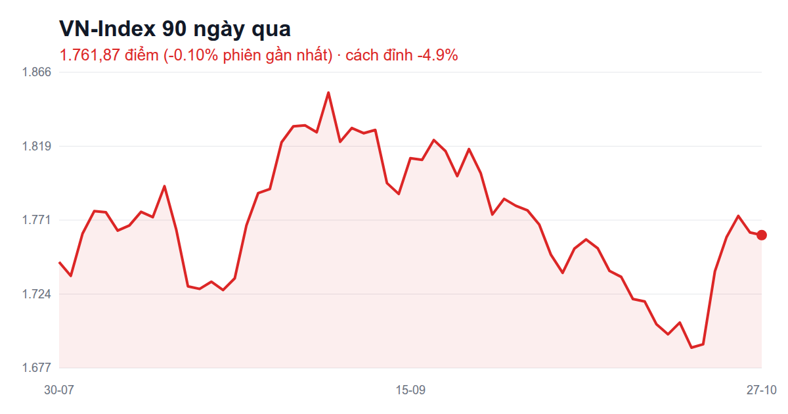
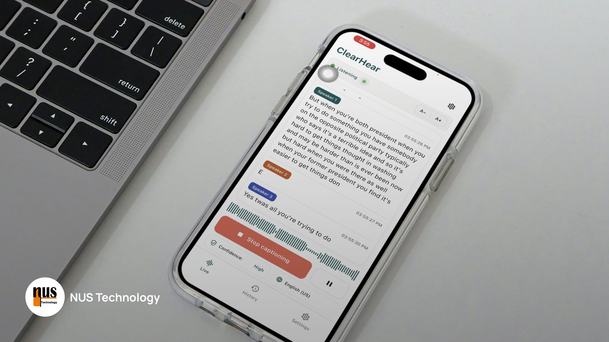
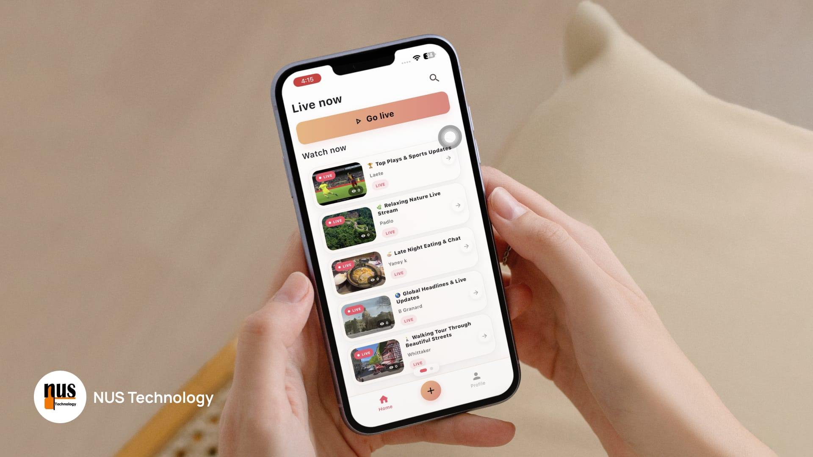

# FB post ứng viên · 2026-10-28 08:45

Bối cảnh: user vừa đăng RMIT (2h), 'Cám ơn ông' (15h), giá vàng/OpenAI (1 ngày), chạy bộ+matxa (3 ngày), chứng khoán (3 ngày). Strava: sáng nay 6,01 km; tháng 225,9 km; năm 972,1 km (còn ~28 km tới 1.000). Kỷ niệm: bé hóa phù thủy Halloween (2 năm), 10 năm kết bạn với Lam. Halloween thứ Bảy 31/10.

### 1. [fb-memory] Kỷ niệm 2 năm: bé hóa phù thủy Halloween — cảm xúc: hạnh phúc
**Nguồn:** Kỷ niệm 2 năm trước — bài của Hoang Thuy Thuy gắn thẻ bé — Facebook Kỷ niệm
> Album bé mặc áo choàng + mũ phù thủy, cầm giỏ bí ngô ở khu ăn uống, caption gốc 'Các cô chú tính cho con kẹo hay muốn bị con ghẹo nè'.

Hai năm trước có cô phù thủy nhỏ đi xin kẹo 🧙‍♀️🍬
Năm nay sắp Halloween, chắc lại phải chuẩn bị kẹo... và ví 😅

### 2. [fb-memory] Kỷ niệm 10 năm kết bạn với Lam — cảm xúc: hạnh phúc
**Nguồn:** Kỷ niệm 'Đoàn và Lam — Kết bạn được 10 năm' — Facebook Kỷ niệm
> Thẻ kỷ niệm tình bạn 10 năm, collage ảnh gia đình: tặng hoa, đám hỏi áo dài, bế em bé.

10 năm kết bạn trên Facebook 🥰
Từ hồi còn trẻ trâu tới giờ đã thành... trâu già 🐃😂

### 3. [stock-humor] FPT lãi kỷ lục mà giá thủng đáy — cảm xúc: ngốc nghếch
**Nguồn:** Cổ phiếu FPT thủng đáy dù báo lãi kỷ lục — Google News (news-digest 28/10)
> Giá FPT tiếp tục giảm dù kết quả kinh doanh cao nhất lịch sử.

Công ty báo lãi kỷ lục 🎉
Cổ phiếu thì báo... thủng đáy 🕳️
Hóa ra làm ăn giỏi chưa chắc đã được thương, giống mình đi làm vậy 🥲

### 4. [stock-humor] VN-Index loay hoay dưới 1.770 — cảm xúc: hoang mang
**Nguồn:** VN-Index giảm nhẹ, kháng cự 1.770 điểm thách thức nhà đầu tư — Google News (news-digest 28/10)
> Vùng 1.770 điểm tiếp tục là ngưỡng cản khó vượt; thị trường giằng co, thanh khoản thấp.

Chỉ số cứ tới cửa 1.770 là quay đầu 🚪
Y chang mình tới cửa phòng gym 😅
Ai cũng đang đứng ngoài cửa điểm danh nào 🙋

### 5. [share-article] SCB lãi tiết kiệm gần 0% — cảm xúc: hoang mang
**Nguồn:** SCB giảm lãi suất tiết kiệm xuống gần 0% — VnExpress, 28/10 — https://vnexpress.net/scb-giam-lai-suat-tiet-kiem-xuong-gan-0-5137507.html
> Từ ngân hàng từng dẫn đầu lãi suất, SCB nay chỉ trả 0,1–0,7%/năm.

Gửi tiết kiệm SCB giờ lãi 0,1%/năm 🐷
Gửi 100 triệu một năm được... ly trà sữa 🧋😂
https://vnexpress.net/scb-giam-lai-suat-tiet-kiem-xuong-gan-0-5137507.html

### 6. [share-article] Xem xét giảm giá điện + thuế xăng từ 1/11 — cảm xúc: hào hứng
**Nguồn:** Phó thủ tướng: xem xét giảm giá điện từ 1/11 — VnExpress, 28/10 — https://vnexpress.net/pho-thu-tuong-xem-xet-giam-gia-dien-tu-1-11-5137612.html
> Đề xuất giảm thuế TTĐB xăng về 0% và giảm giá điện bình quân trong 5 tháng.

Nghe nói sắp giảm giá điện với xăng ⚡⛽
Tháng này bật máy lạnh đỡ run tay hơn rồi 😆
https://vnexpress.net/pho-thu-tuong-xem-xet-giam-gia-dien-tu-1-11-5137612.html

### 7. [share-article] Vàng bạc giảm liên tục — cảm xúc: hết tiền
**Nguồn:** Giá vàng bạc giảm liên tục, nhà đầu tư lỗ nặng — Tuổi Trẻ, 28/10 — https://tuoitre.vn/gia-vang-bac-giam-mai-nha-dau-tu-lo-nang-100261028000022196.htm
> Vàng thế giới có lúc rơi xuống 3.990 USD/ounce rồi bật lên 4.060 USD; người mua đỉnh lỗ nặng.

Tuần trước khoe vàng nhẫn giảm, tuần này vàng vẫn giảm tiếp 📉
Người mua rồi thì im lặng, người chưa mua thì... cũng im lặng vì hết tiền 🤐
https://tuoitre.vn/gia-vang-bac-giam-mai-nha-dau-tu-lo-nang-100261028000022196.htm

### 8. [nus-blog] ClearHear: phụ đề trực tiếp khi tắt mạng — cảm xúc: hào hứng
**Nguồn:** Live Captions With the Internet Switched Off: Inside ClearHear — NUS Technology blog — https://www.nustechnology.com/blog/live-captions-with-the-internet-switched-off-inside-clearhear
> Dự án đầu tiên của NUS Labs: app điện thoại nghe mic và hiện phụ đề ngay trên máy, không cần mạng/server, lưu và tóm tắt trên máy; khó vì phải vừa trực tiếp vừa offline vừa mượt.

Bật chế độ máy bay, nói chuyện, phụ đề vẫn chạy ra từng chữ ✈️💬
Công ty mình làm app này, khỏi cần mạng luôn. Ai lãng tai thử xem 😄
https://www.nustechnology.com/blog/live-captions-with-the-internet-switched-off-inside-clearhear

### 9. [nus-blog] Zuzu: app livestream không đứng hình khi vào thang máy — cảm xúc: tích cực
**Nguồn:** Building a Real-Time Mobile Livestreaming App with Flutter, LiveKit and WebRTC — NUS Technology blog — https://www.nustechnology.com/blog/building-a-real-time-mobile-livestreaming-app-with-flutter-livekit-and-webrtc
> Dự án thứ 2 NUS Labs: app livestream iOS/Android; phần khó là xử lý khi mất sóng, đổi Wi-Fi sang 4G, app bị ẩn — người xem không bị treo hình.

Livestream thì dễ, khó là lúc người phát bước vô thang máy 🛗📵
Team mình làm thử app Zuzu để xử mấy pha "rớt mạng giữa chừng" đó 😅
https://www.nustechnology.com/blog/building-a-real-time-mobile-livestreaming-app-with-flutter-livekit-and-webrtc

### 10. [nus-blog] AI tự thêm mô tả ảnh cho tài liệu — cảm xúc: tích cực
**Nguồn:** Automating Document Accessibility: Patching Raw OOXML and Parsing PDF Structure Trees with AI — NUS Technology blog — https://www.nustechnology.com/blog/automating-document-accessibility-patching-raw-ooxml-and-parsing-pdf-structure-trees-with-ai
> Hệ thống AI tự thêm tiêu đề và mô tả ảnh (alt-text) vào PDF/Word/PowerPoint để đạt chuẩn tiếp cận cho người khiếm thị, không làm vỡ bố cục file.

Có những người đọc tài liệu bằng tai chứ không bằng mắt 👂📄
Team mình dùng AI tự ghi chú thích cho ảnh, tiêu đề trong file Word, PDF giúp họ đọc dễ hơn 🙌
https://www.nustechnology.com/blog/automating-document-accessibility-patching-raw-ooxml-and-parsing-pdf-structure-trees-with-ai

### 11. [trend] Halloween hóa trang theo màu kẹo — cảm xúc: ngốc nghếch
**Nguồn:** Trend hóa trang theo màu kẹo mùa Halloween — Kenh14 — https://kenh14.vn/kieu-trang-diem.html
> Chupa Chups khởi xướng trend biến hình theo màu kẹo, TikToker hưởng ứng, giới trẻ đua nhau thử.

Giới trẻ đua nhau hóa trang màu kẹo mút cho Halloween 🍭🎃
Mình thì khỏi hóa trang, sáng thứ Hai mở app chứng khoán là mặt đã đủ đáng sợ 👻
https://kenh14.vn/kieu-trang-diem.html

### 12. [trend] Trả lời bằng 1 từ (Answer in One Word) — cảm xúc: ngốc nghếch
**Nguồn:** TikTok Trends: October 2026 — Answer in One Word — NewEngen — https://newengen.com/insights/tiktok-trends/
> Người dùng TikTok hỏi bạn bè/gia đình/ChatGPT câu hỏi cá nhân và bắt trả lời chỉ bằng 1 từ.

Trend mới: trả lời mọi câu hỏi bằng đúng 1 từ ☝️
Tiền đâu? "Hết". Chứng khoán? "Xanh... rêu" 😂
Ai chơi thử dưới comment nào 👇
https://newengen.com/insights/tiktok-trends/

### 13. [trend] Clip xếp hạng áo UNIQLO thu đông — cảm xúc: thư thái
**Nguồn:** Lướt clip săn đồ Thu/Đông đang viral: xếp hạng 6 chiếc áo UNIQLO hot hit nhất 2026 — Kenh14, 27/10 — https://kenh14.vn/luot-clip-san-do-thu-dong-dang-viral-xep-hang-6-chiec-ao-uniqlo-hot-hit-nhat-2026-215261027165019537.chn
> Clip review/xếp hạng áo thu đông UNIQLO đang viral trên mạng.

Mạng đang rần rần clip xếp hạng áo khoác thu đông 🧥
Sài Gòn thì có 2 mùa: nóng và... nóng có gió 🌬️😅
https://kenh14.vn/luot-clip-san-do-thu-dong-dang-viral-xep-hang-6-chiec-ao-uniqlo-hot-hit-nhat-2026-215261027165019537.chn

### 14. [running] Buổi chạy 6 km sáng nay — cảm xúc: khỏe mạnh
**Nguồn:** Chạy bộ buổi sáng 28/10 — 6,01 km, 33 phút, pace 5:32/km — Strava — https://www.strava.com/activities/20758061566
> Buổi chạy sáng nay.

Sáng nay 6 km, 33 phút 🏃‍♂️
Chân mỏi nhưng đầu nhẹ, chuẩn bị vô làm việc thôi 💪
https://www.strava.com/activities/20758061566

### 15. [running] Còn 28 km là cán 1.000 km năm nay — cảm xúc: hào hứng
**Nguồn:** Strava: năm 2026 972,1 km, tháng 10 225,9 km — Strava — https://www.strava.com/activities/20758061566
> Tổng năm 972,1 km (từ 19/5), còn 27,9 km tới 1.000 km.

Năm nay chạy được 972 km rồi 🏃‍♂️
Còn 28 km nữa là chạm mốc 1.000 🎯
Ai chạy cùng đoạn cuối không nè 😆
https://www.strava.com/activities/20758061566

### 16. [running] Tháng 10 gần 226 km — cảm xúc: khỏe mạnh
**Nguồn:** Strava: tháng 10 225,9 km, tuần này 16 km — Strava — https://www.strava.com/activities/20758061566
> Tổng tháng 10 tới 28/10 = 225,9 km.

Tháng 10 chạy được 226 km 🏃‍♂️
Tính ra mỗi ngày hơn 7 km, chân chạy chăm hơn... tài khoản chứng khoán 😂
https://www.strava.com/activities/20758061566

Ghi chú: bài 3–4 nguồn chỉ có link news.google (chưa giải ra URL gốc), bài không gắn link nên không ảnh hưởng; ảnh = VN-Index sẽ đăng.

Chọn bài: /me:fb-post --pick <số>
