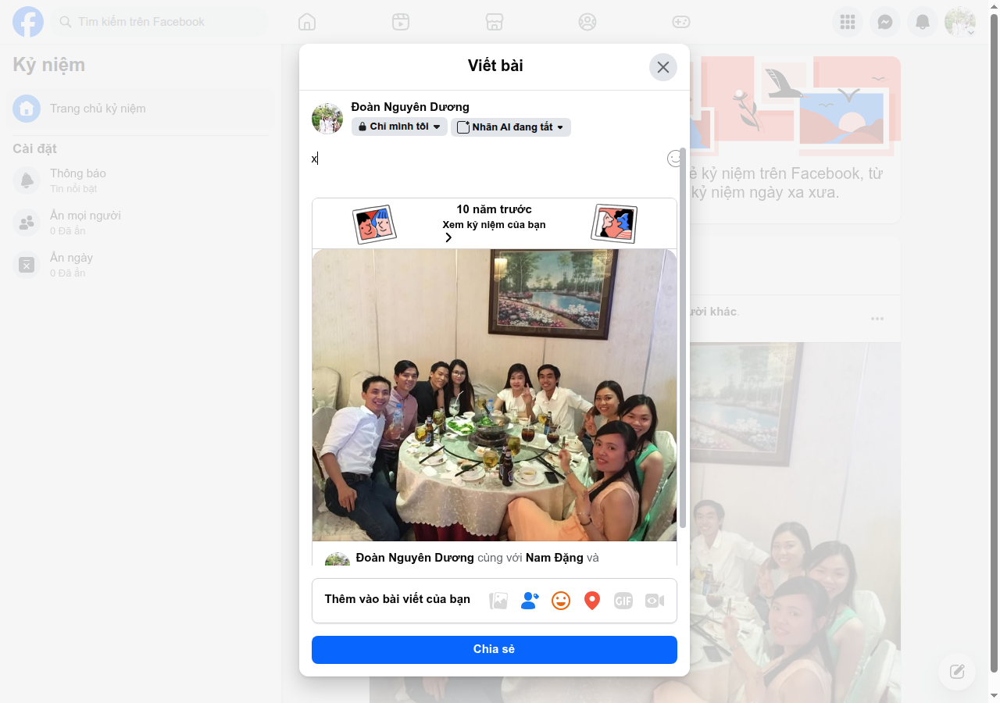
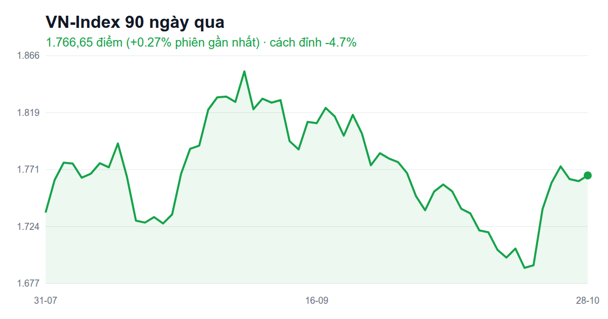

# FB post ứng viên · 2026-10-29 08:45

Bối cảnh: user vừa đăng AWS MFA (21h), RMIT + 'Cám ơn ông' (1 ngày), giá vàng (2 ngày), chạy bộ+matxa & chứng khoán (4 ngày). Strava: sáng nay 5,01 km pace 4:58; tuần 21 km; tháng 230,9 km; năm 977,1 km (còn ~23 km tới 1.000). Kỷ niệm 10 năm: hội bạn bàn tiệc, video hát sân khấu. Không có file ý tưởng mới.

### 1. [fb-memory] Kỷ niệm 10 năm: hội bạn quây quần bàn tiệc — cảm xúc: hạnh phúc
**Nguồn:** Kỷ niệm 10 năm trước — bài của Đoàn Nguyên Dương cùng Nam Đặng và 39 người khác — Facebook Kỷ niệm
> Ảnh hơn chục bạn bè ngồi quanh bàn tròn nhà hàng (lẩu, bia), cười, giơ tay chữ V.

10 năm trước cả đám còn ngồi chung 1 bàn tiệc 🍻
Giờ hẹn được đủ người chắc phải đặt lịch trước... 10 năm nữa 😂

### 2. [fb-memory] Kỷ niệm 10 năm: trai Cam Ranh lên sân khấu hát — cảm xúc: ngốc nghếch
**Nguồn:** Kỷ niệm 29/10/2016 — Đoàn Nguyên Dương cùng Vương Trần — Facebook Kỷ niệm
> Video user đứng hát trên sân khấu tiệc (đèn LED tím xanh), caption gốc 'Trai Cam Ranh mấy bác ạ. Đẹp trai còn hát hay nữa'.

10 năm trước còn dám cầm mic lên sân khấu 🎤
Giờ chỉ dám hát... trong nhà tắm 🚿😅

### 3. [stock-humor] VN-Index đảo chiều phút chót — cảm xúc: hoang mang
**Nguồn:** Chứng khoán 28/10: Lực cầu cuối phiên giúp VN-Index đảo chiều tăng — Google News (news-digest 29/10)
> Dòng tiền vào cuối phiên kéo chỉ số từ đỏ sang xanh, VN-Index đóng cửa ~1.766.

Cả phiên đỏ lè, mình tắt app cho đỡ đau 📉
Tới cuối phiên nó quay xe xanh lét 📈
Thị trường đúng kiểu người yêu cũ: mình đi rồi mới tốt lên 🙃

### 4. [stock-humor] Cán bộ UBCK cũng xin nghỉ khi thị trường nóng — cảm xúc: hết tiền
**Nguồn:** 180 cán bộ UBCK từng xin nghỉ việc khi thị trường 'nóng' — Google News (news-digest 29/10)
> Thời thị trường sôi động, cơ quan quản lý mất nhiều nhân sự xin nghỉ.

Đọc tin thị trường nóng là có người xin nghỉ việc đi đầu tư 🔥
Mình thì ngược lại: chơi chứng khoán xong càng phải đi làm chăm hơn 💼😅

### 5. [running] Còn 23 km là cán 1.000 km năm nay — cảm xúc: hào hứng
**Nguồn:** Strava: năm 2026 977,1 km — Strava — https://www.strava.com/activities/20771703119
> Tổng năm 977,1 km (từ 19/5), còn 22,9 km tới 1.000 km.

Năm nay chạy được 977 km rồi 🏃‍♂️
Còn đúng 23 km, tầm 4–5 buổi nữa là chạm 1.000 🎯
Ai đặt cược giùm mình kịp trước tháng 11 không 😆
https://www.strava.com/activities/20771703119

### 6. [running] Sáng nay 5 km dưới 5 phút/km — cảm xúc: khỏe mạnh
**Nguồn:** Chạy bộ buổi sáng 29/10 — 5,01 km, 25 phút, pace 4:58/km — Strava — https://www.strava.com/activities/20771703119
> Buổi chạy sáng nay; tuần này 21 km.

Sáng nay 5 km trong 25 phút ☀️
Chạy nhanh vì... sợ trễ giờ làm 😂
https://www.strava.com/activities/20771703119

### 7. [running] Tháng 10 gần 231 km — cảm xúc: tích cực
**Nguồn:** Strava: tháng 10/2026 230,9 km — Strava — https://www.strava.com/activities/20771703119
> Tổng tháng 10: 230,9 km; tuần này 21 km.

Tháng 10 chạy gần 231 km rồi 👟
Đôi giày mòn, ví cũng mòn theo vì ăn sau khi chạy 🍜😅
https://www.strava.com/activities/20771703119

### 8. [nus-blog] App chạy nhanh mà điểm vẫn chậm (Shopify) — cảm xúc: tích cực
**Nguồn:** How to Measure and Improve LCP in a Shopify Embedded App — NUS Technology blog, 07/10/2026 — https://www.nustechnology.com/blog/how-to-measure-and-improve-lcp-in-a-shopify-embedded-app
> App Shopify cảm giác nhanh nhưng Shopify chấm tải chậm; cách làm: đo xem phần tử to nhất trên trang là gì rồi tăng tốc đúng phần tử đó (ảnh, chặn hiển thị, truy vấn chậm).

App mình thấy chạy nhanh, khách không chê, mà bảng điểm vẫn báo "chậm" 🐢
Bí quyết: tìm đúng cái thứ nặng nhất trên màn hình rồi sửa nó thôi 🔍
https://www.nustechnology.com/blog/how-to-measure-and-improve-lcp-in-a-shopify-embedded-app

### 9. [nus-blog] Chọn công nghệ: nghĩ tới năm thứ 3 — cảm xúc: thư thái
**Nguồn:** Rails vs Node.js for a SaaS Backend in 2026: An Honest Engineering Decision — NUS Technology blog, 28/07/2026 — https://www.nustechnology.com/blog/rails-vs-node-js-for-a-saas-backend-in-2026-an-honest-engineering-decision
> So Rails và Node.js không chỉ ở tốc độ làm bản đầu, mà ở năm thứ 3 khi team đông, việc nhiều, hóa đơn server tăng.

Chọn đồ nghề làm phần mềm, ai cũng so ngày đầu ai nhanh hơn ⚡
Mà cái đáng lo là 3 năm sau còn sửa nổi không 😅
https://www.nustechnology.com/blog/rails-vs-node-js-for-a-saas-backend-in-2026-an-honest-engineering-decision

### 10. [nus-blog] 1 cửa hàng thì dễ, 10 cửa hàng mới khó — cảm xúc: hào hứng
**Nguồn:** n8n eCommerce Automation as a Multi-Tenant SaaS: Inside Our Ecom Automation Demo — NUS Technology blog, 17/09/2026 — https://www.nustechnology.com/blog/n8n-ecommerce-automation-as-a-multi-tenant-saas-inside-our-ecom-automation-demo
> Demo của NUS Labs tự động khâu kho–giao hàng–báo tin cho đơn Shopify, làm thành app nhiều cửa hàng cùng đăng ký dùng; có demo + mã nguồn.

Tự động hóa đơn hàng cho 1 cửa hàng: 1 buổi chiều ☕
Cho 10 cửa hàng cùng dùng: chuyện dài tập 📦😂
https://www.nustechnology.com/blog/n8n-ecommerce-automation-as-a-multi-tenant-saas-inside-our-ecom-automation-demo

### 11. [nus-blog] Chép dữ liệu thì dễ, giữ cho đúng mới khó — cảm xúc: ngốc nghếch
**Nguồn:** How to Keep Mindbody Data in Sync With Your Own Database — NUS Technology blog, 25/09/2026 — https://www.nustechnology.com/blog/how-to-keep-mindbody-data-in-sync-with-your-own-database
> Lấy dữ liệu từ phần mềm quản lý phòng tập về rất dễ; khó là giữ đúng khi lịch bị hủy, khách bị gộp, đổi giờ — lỗi không báo, cứ âm thầm lệch.

Chép danh sách khách về máy: xong trong 1 buổi chiều 😎
Giữ cho nó đúng suốt 2 năm: đó mới là cả dự án 😅
https://www.nustechnology.com/blog/how-to-keep-mindbody-data-in-sync-with-your-own-database

### 12. [share-article] Tesla tuyển người ở Việt Nam — cảm xúc: hào hứng
**Nguồn:** Tesla tuyển nhân sự ở Việt Nam — VnExpress, 28/10/2026 — https://vnexpress.net/tesla-tuyen-nhan-su-o-viet-nam-5138056.html
> Sau một tháng lập công ty, Tesla tuyển 5 vị trí quản lý/chuyên gia tại VN.

Tesla mới lập công ty ở Việt Nam đã đăng tuyển rồi 🚗⚡
CV mình chắc chưa đủ, thôi để dành tiền... mua xe trước 😅
https://vnexpress.net/tesla-tuyen-nhan-su-o-viet-nam-5138056.html

### 13. [share-article] Ống hút giấy có thể hại môi trường hơn nhựa — cảm xúc: hoang mang
**Nguồn:** Ống hút giấy có thể gây ảnh hưởng môi trường gấp nhiều lần nhựa — VnExpress, 28/10/2026 — https://vnexpress.net/ong-hut-giay-co-the-gay-anh-huong-moi-truong-gap-nhieu-lan-nhua-5137770.html
> Nghiên cứu cho thấy sản xuất ống hút giấy có thể gây hại môi trường nhiều hơn nhựa, gồm nguy cơ ảnh hưởng tầng ozone.

Bao năm uống trà sữa bằng ống hút giấy mềm nhũn cho "xanh" 🧋
Giờ đọc tin nó có khi hại hơn nhựa... cú lừa thế kỷ 🫠
https://vnexpress.net/ong-hut-giay-co-the-gay-anh-huong-moi-truong-gap-nhieu-lan-nhua-5137770.html

### 14. [share-article] Chrome tự điền form bằng thông tin trong Gmail — cảm xúc: ngốc nghếch
**Nguồn:** Chrome's AI-powered autofill can now dig through your Gmail to fill out forms — TechCrunch, 28/10/2026 — https://techcrunch.com/2026/10/28/chromes-ai-powered-autofill-can-now-dig-through-your-gmail-to-fill-out-forms/
> Tính năng tự điền của Chrome có thể lấy thông tin vé máy bay, đơn hàng… từ email Gmail để điền form.

Chrome giờ tự lục Gmail để điền form giùm 📧
Tiện thì tiện, mà nó biết mình đặt bao nhiêu đơn online chắc cũng ngại 🙈
https://techcrunch.com/2026/10/28/chromes-ai-powered-autofill-can-now-dig-through-your-gmail-to-fill-out-forms/

### 15. [trend] Đừng bao giờ khinh thường một bông hoa chưa nở — cảm xúc: ngốc nghếch
**Nguồn:** Trend 'Đừng bao giờ khinh thường một bông hoa chưa nở' — Mạng xã hội VN (bài 28/10/2026) — https://thanhnien.vn/gioi-tre/the-gioi-mang.htm
> Dân mạng khoe ảnh ngày xưa đặt cạnh ảnh hiện tại để chứng minh sức mạnh thời gian; nhiều người nổi tiếng tham gia.

Thấy mọi người khoe ảnh xưa theo trend "đừng khinh thường bông hoa chưa nở" 🌸
Mình lục ảnh cũ thì thấy... hoa nở rồi lại héo 🥀😂

### 16. [trend] Trend nhảy "Ai đưa em về" — cảm xúc: ngốc nghếch
**Nguồn:** Trend nhảy 'Ai đưa em về' trên TikTok VN — TikTok Discover (đầu 10/2026) — https://www.tiktok.com/discover/trending-now-on-tiktok-vietnam
> Trend nhảy theo bài "Ai đưa em về" đang có nhiều clip hướng dẫn; độ hot chưa có báo xác nhận.

Lướt TikTok toàn thấy nhảy "Ai đưa em về" 💃
Mình tập thử 5 phút, kết quả: không ai đưa về, chỉ có đau lưng 😵‍💫
https://www.tiktok.com/discover/trending-now-on-tiktok-vietnam

---
Ghi chú: không có `idea` (docs/fb-post-ideas/ chỉ có README). Trend tuần này ít nguồn: #15 không có link bài gốc (search không ra), #16 chỉ có trang TikTok Discover, chưa có báo xác nhận. Stock-humor #3/#4 link news.google (chưa resolve được URL gốc).

Chọn bài: /me:fb-post --pick <số>
