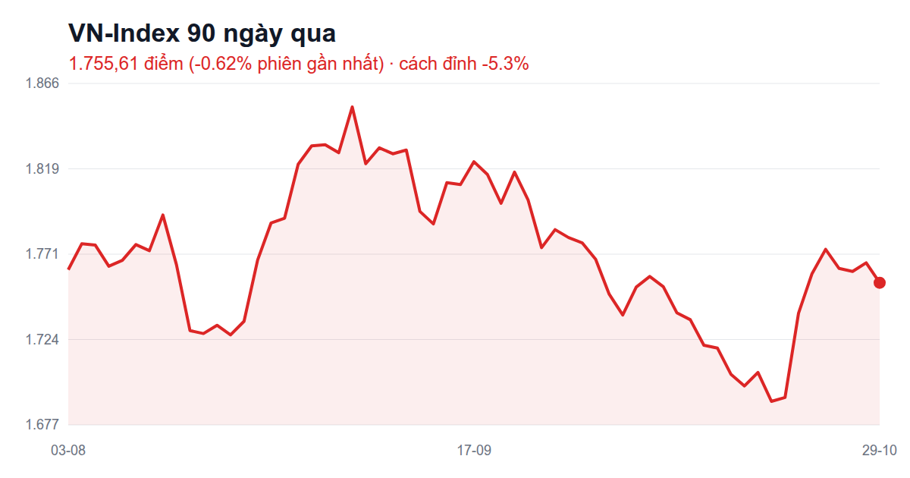
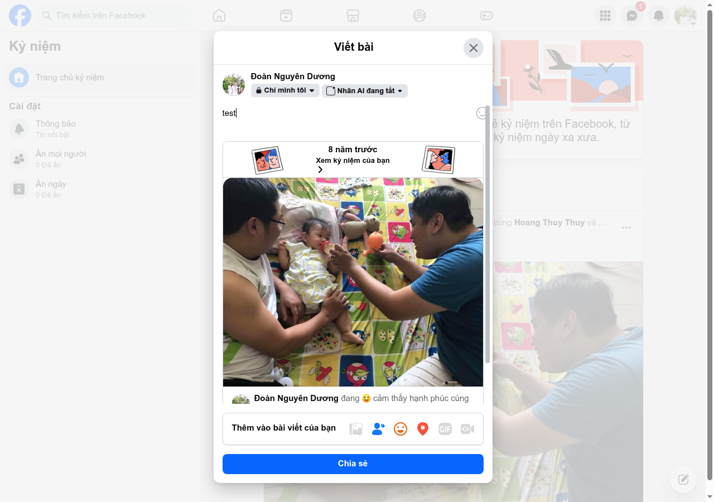
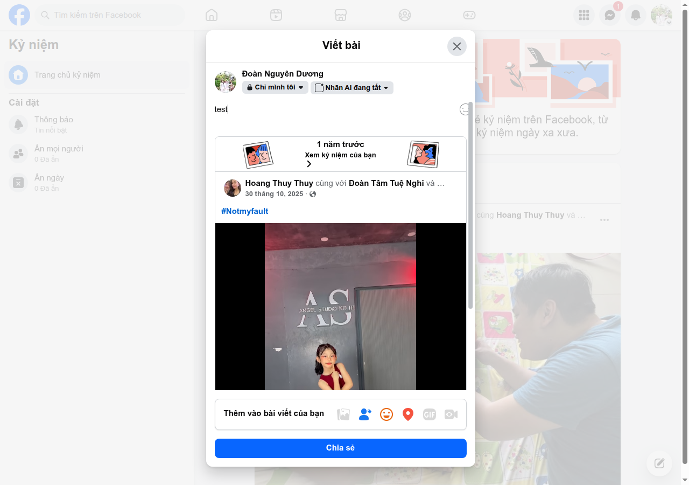
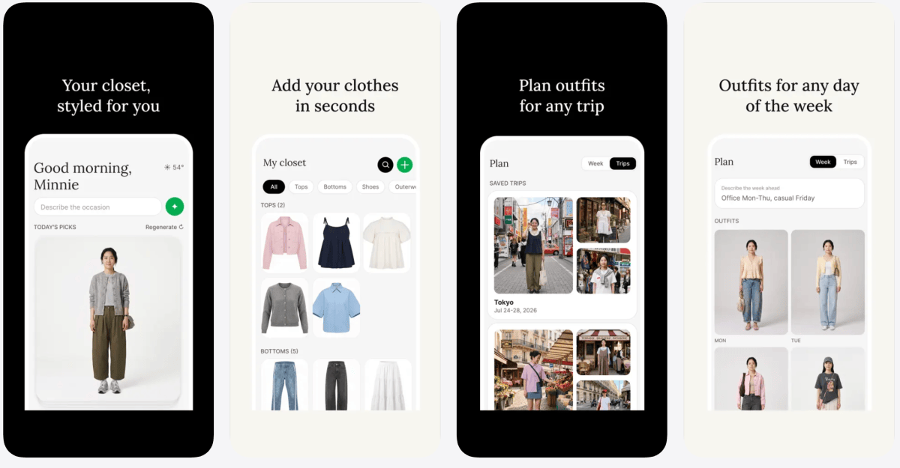

# FB post candidates — 30/10/2026 08:45

Bối cảnh: user 3 ngày qua đã đăng "Hành trình ngàn dặm…" (hôm qua), AWS MFA, RMIT, giá vàng → hạ ưu tiên vàng/AWS. Strava: sáng nay 10 km, năm 987,1 km (còn 12,9 km tới 1.000), tháng 240,9 km, chưa có milestone. Kỷ niệm: 2 cái (8 năm: cho em bé bú bình; 1 năm: bé ở studio). VN-Index 29/10 giảm về 1.755,61.

### 1. [stock-humor] VN-Index quay đầu, dầu khí lao dốc — cảm xúc: hoang mang
**Nguồn:** Chứng khoán 29/10: Áp lực bán lan rộng, VN-Index quay đầu giảm / Cổ phiếu dầu khí lao dốc, VN-Index mất hơn 11 điểm — news-digest 30/10 (VnEconomy, báo VN) — (không link)
> VN-Index đảo chiều giảm >11 điểm, nhóm dầu khí bị bán mạnh, thử vùng 1.740.

Hôm qua vừa hí hửng thấy xanh 🌱
Hôm nay dầu khí rủ nhau đi chơi cầu tuột 🛝
Tài khoản mình thì như ly trà đá: càng uống càng vơi 🫠

### 2. [stock-humor] Cổ phiếu quen thuộc về đáy 3 năm — cảm xúc: hết tiền
**Nguồn:** Cổ phiếu "thủng" đáy 3 năm, FPT phát thông báo quan trọng — news-digest 30/10 — (không link)
> Một cổ phiếu công nghệ lớn rơi về vùng thấp nhất 3 năm, doanh nghiệp lên tiếng.

Người ta bảo mua ở đáy là thắng 🏆
Đáy 3 năm đây rồi... mà ví mình cũng chạm đáy luôn 🥲
Đúng là ý trời 😅

### 3. [fb-memory] 8 năm trước: hai ông bố tập cho em bé bú bình — cảm xúc: hạnh phúc
**Nguồn:** Gia đình “nhỏ”, hạnh phúc to — Đoàn Nguyên Dương, 30/10/2018 — (không link)
> Ảnh 2 người đàn ông ngồi trên thảm chơi, cho em bé uống bình sữa; tag 40+ người.

8 năm trước: 2 ông tướng xúm lại cho 1 em bé bú bình 🍼
Giờ em lớn rồi, còn 2 ông thì... vẫn vụng y vậy 😆
Gia đình nhỏ, hạnh phúc to ❤️

### 4. [fb-memory] 1 năm trước: bé tạo dáng ở studio #Notmyfault — cảm xúc: hạnh phúc
**Nguồn:** #Notmyfault — Hoang Thuy Thuy cùng Đoàn Tâm Tuệ Nghi, 30/10/2025 — (không link)
> Clip bé gái áo đỏ tạo dáng trước tường chữ 'Angel Studio' (lớp nhảy/studio).

Mới 1 năm mà nhìn lại thấy con ra dáng idol ghê 📸
Ba thì vẫn chỉ biết đứng ngoài cầm túi 😂💕

### 5. [running] Còn 12,9 km là cán 1.000 km năm nay — cảm xúc: hào hứng
**Nguồn:** Chạy bộ buổi sáng — Strava, 30/10/2026 — https://www.strava.com/activities/20785066677
> 10 km, 60 phút, pace 5:58/km. Năm nay 987,1 km.

Sáng nay chạy thêm 10 km, giờ còn đúng 12,9 km là chạm mốc 1.000 km năm nay 🏃‍♂️
Cuối tuần này chắc phải tự thưởng 1 buổi "về đích" 🎯🔥
https://www.strava.com/activities/20785066677

### 6. [running] Sáng nay 10 km, tuần đã 31 km — cảm xúc: khỏe mạnh
**Nguồn:** Chạy bộ buổi sáng — Strava, 30/10/2026 — https://www.strava.com/activities/20785066677
> 10 km / 60 phút / 5:58 mỗi km; tuần 31 km.

Thứ Năm dậy sớm làm 10 km cho tỉnh ngủ ☀️
Tuần này mới đó đã 31 km, chân thì kêu mà lòng thì vui 😆🏃‍♂️
https://www.strava.com/activities/20785066677

### 7. [running] Tháng 10 đã 240,9 km — cảm xúc: tích cực
**Nguồn:** Tổng tháng 10 — Strava — https://www.strava.com/activities/20785066677
> Tổng tháng 10/2026: 240,9 km, 166 buổi từ 05/2026.

Tháng 10 chưa hết mà đôi giày đã đi được 240,9 km 👟
Tiền xăng thì tiết kiệm, tiền ăn sáng thì tăng 😂🍜

### 8. [nus-blog] Đừng giấu chìa khoá dưới thảm chùi chân — cảm xúc: tích cực
**Nguồn:** React Native + Mindbody API: Build It the Secure Way — NUS Technology blog, 14/10/2026 — https://www.nustechnology.com/blog/react-native-mindbody-api-build-it-the-secure-way
> Khoá truy cập nhét trong app điện thoại thì ai cũng moi ra được trong vài phút; nên để 1 máy chủ ở giữa giữ khoá và lo việc đặt lịch.

Giấu chìa khoá nhà dưới thảm chùi chân thì ai cũng tìm ra 🔑😅
Làm app điện thoại cũng vậy, đồ quan trọng phải để ở chỗ khác. Team mình có viết bài kể chuyện này nè
https://www.nustechnology.com/blog/react-native-mindbody-api-build-it-the-secure-way

### 9. [nus-blog] Viết lại hay sửa dần phần mềm cũ — cảm xúc: tích cực
**Nguồn:** Rewrite vs. Refactor: Why We Almost Always Choose Incremental Modernization — NUS Technology blog — https://www.nustechnology.com/blog/rewrite-vs-refactor-why-we-almost-always-choose-incremental-modernization
> Vì sao đập đi viết lại thường thất bại, và cách sửa dần từng phần để hệ thống vẫn chạy. (đã đề xuất 26/10, chưa đăng)

Nhà cũ thì sửa dần hay đập đi xây lại? 🏠🔨
Phần mềm cũng vậy, và team mình thường chọn sửa dần cho chắc ăn 😄
https://www.nustechnology.com/blog/rewrite-vs-refactor-why-we-almost-always-choose-incremental-modernization

### 10. [share-article] Xuất nhập khẩu lần đầu vượt 1.000 tỷ USD — cảm xúc: hào hứng
**Nguồn:** Lần đầu kim ngạch xuất nhập khẩu vượt 1.000 tỷ USD — VnExpress, 29/10/2026 — https://vnexpress.net/lan-dau-kim-ngach-xuat-nhap-khau-vuot-1-000-ty-usd-5138495.html
> Đến 29/10 tổng xuất nhập khẩu hàng hoá đạt hơn 1.000 tỷ USD, lần đầu vượt mốc, theo Cục Hải quan.

Cả nước buôn bán với thế giới vượt 1.000 tỷ USD, lần đầu tiên luôn 🇻🇳📦
Còn mình buôn bán với sàn chứng khoán thì... thôi khỏi kể 😅
https://vnexpress.net/lan-dau-kim-ngach-xuat-nhap-khau-vuot-1-000-ty-usd-5138495.html

### 11. [share-article] Reddit sắp bắt đăng nhập mới đọc — cảm xúc: ngốc nghếch
**Nguồn:** As search traffic dries up, Reddit announces it's shifting to a logged-in experience — TechCrunch, 29/10/2026 — https://techcrunch.com/2026/10/29/as-search-traffic-dries-up-reddit-announces-its-shifting-to-a-logged-in-experience/
> Người dùng tìm thông tin qua AI nhiều hơn, lượt vào từ Google giảm, nên Reddit chuyển dần sang bắt đăng nhập.

Hồi giờ hỏi gì cũng search kèm chữ "reddit" 🔍
Giờ Reddit tính bắt đăng nhập mới cho đọc, vì người ta hỏi AI hết rồi 🤖😂
https://techcrunch.com/2026/10/29/as-search-traffic-dries-up-reddit-announces-its-shifting-to-a-logged-in-experience/

### 12. [share-article] Meta ra app tủ đồ ảo từ ảnh Instagram — cảm xúc: hào hứng
**Nguồn:** Meta quietly launches an AI fashion app called Style Sketch — TechCrunch, 29/10/2026 — https://techcrunch.com/2026/10/29/meta-quietly-launches-an-ai-fashion-app-called-style-sketch/
> App nối với Instagram, dựng tủ đồ ảo từ ảnh đã đăng hoặc chụp thêm đồ, rồi gợi ý phối đồ.

Meta ra app gom hết đồ mình từng mặc trên Instagram thành tủ đồ ảo 👕👗
Mở ra chắc thấy 10 tấm thì 9 tấm cùng 1 cái áo 😂
https://techcrunch.com/2026/10/29/meta-quietly-launches-an-ai-fashion-app-called-style-sketch/

### 13. [trend] Mai Halloween, cả mạng đua hoá trang — cảm xúc: ngốc nghếch
**Nguồn:** Halloween 31/10 — Trend mạng xã hội quốc tế / VN cuối tháng 10 — (không link)
> Cuối tháng 10 mạng xã hội tràn ảnh/clip hoá trang Halloween (31/10). Không link cụ thể.

Mai Halloween, cả mạng đang đua nhau hoá trang ma quỷ 🎃👻
Mình khỏi cần, mở app chứng khoán ra là mặt tự tái mét rồi 😱

### 14. [trend] "Về nghe sen kể chuyện" — poster trend trên FB — cảm xúc: thư thái
**Nguồn:** Trend poster "Về nghe sen kể chuyện" — Thanh Niên — Thế giới mạng — https://thanhnien.vn/gioi-tre/the-gioi-mang.htm
> Thanh Niên ghi nhận trend làm poster "Về nghe sen kể chuyện" trên Facebook (trang tổng hợp, không ghi rõ ngày).

Thấy mọi người làm poster "Về nghe sen kể chuyện" đẹp quá 🪷
Mình mà làm chắc thành "Về nghe sếp kể chuyện" 😂📋
https://thanhnien.vn/gioi-tre/the-gioi-mang.htm

---
Ghi chú: blog NUS mới chỉ còn 1 bài chưa share (bài Typesense trả 404) → #9 dùng lại bài 26/10 chưa đăng. Trend tuần này ít nguồn VN có ngày rõ; #14 nguồn là trang tổng hợp.

Chọn bài: /me:fb-post --pick <số>